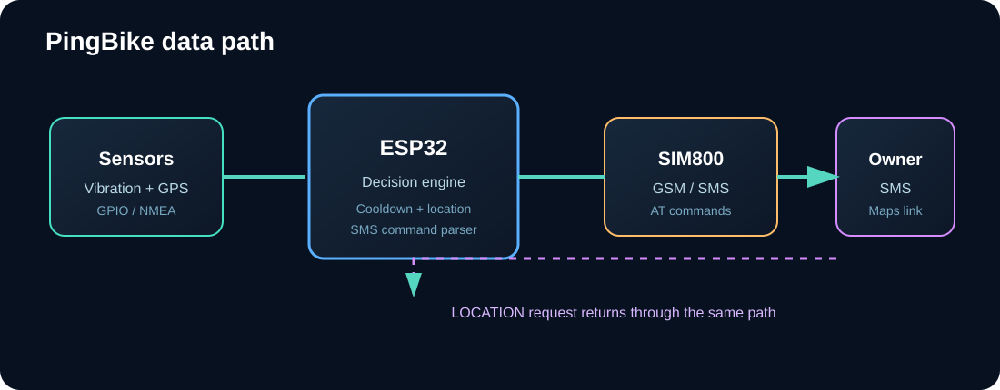
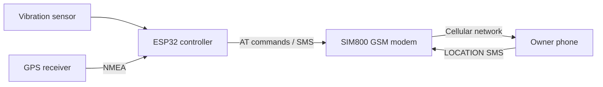
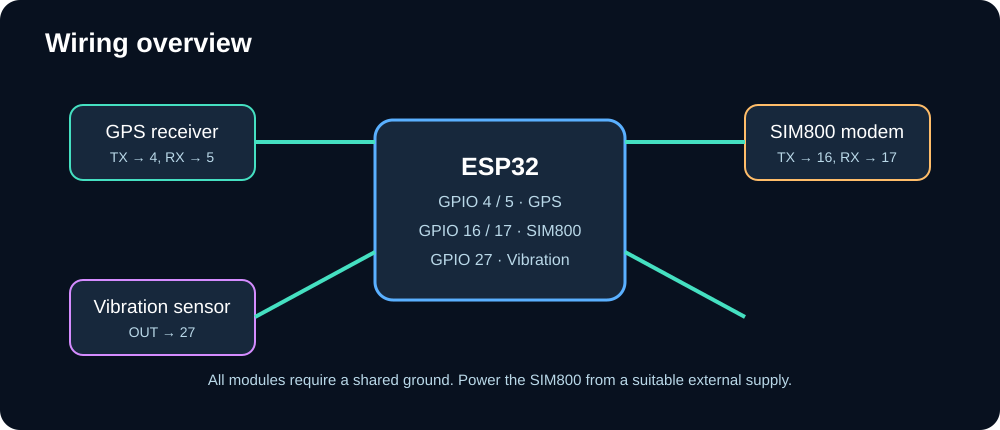
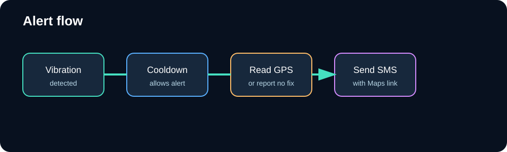

# PingBike


An ESP32-based bike anti-theft monitor that combines a vibration sensor, GPS receiver, and SIM800 GSM modem. When motion is detected, PingBike sends an SMS alert containing the bike's current coordinates and a Google Maps link. You can also request the latest location by SMS.

## Features

- Vibration-triggered anti-theft alerts
- GPS coordinate acquisition with the bundled TinyGPSPlus library
- SMS notifications through a SIM800-compatible GSM modem
- Google Maps link in every alert when a GPS fix is available
- SMS `LOCATION` command for on-demand tracking
- 30-second alert cooldown to reduce notification flooding
- Serial diagnostics for GPS, vibration, modem, and SMS activity

## System overview





## Hardware

| Component | ESP32 connection | Purpose |
| --- | --- | --- |
| GPS TX | GPIO 4 (`GPS_RX`) | GPS data into ESP32 |
| GPS RX | GPIO 5 (`GPS_TX`) | ESP32 data to GPS |
| SIM800 TX | GPIO 16 (`SIM_RX`) | Modem data into ESP32 |
| SIM800 RX | GPIO 17 (`SIM_TX`) | ESP32 data to modem |
| Vibration sensor output | GPIO 27 | Motion detection |
| GPS and SIM800 power | External regulated supplies | Use module-specific voltage/current requirements |



> **Power warning:** SIM800 modules can draw high burst current during transmission. Use a suitable regulated supply, common ground, and correct logic levels. Do not power the modem directly from an ESP32 3.3 V pin unless your hardware explicitly supports it.

## Installation

1. Install the ESP32 board package in Arduino IDE.
2. Open `PingBike.ino`.
3. The required `TinyGPSPlus` library is included under [`libraries/TinyGPSPlus`](libraries/TinyGPSPlus).
4. Insert an active SIM card into the SIM800 modem.
5. Replace the placeholder in `OWNER_NUMBER`:

   ```cpp
   const char OWNER_NUMBER[] = "YOUR_PHONE_NUMBER";
   ```

6. Confirm the pin assignments and baud rates match your wiring.
7. Select the correct ESP32 board and serial port.
8. Upload the sketch and open Serial Monitor at `115200` baud.

## How it works



1. The ESP32 continuously parses NMEA data from the GPS receiver.
2. It reads the vibration sensor every loop.
3. A high vibration signal triggers an alert if the cooldown has expired.
4. The modem sends the latest coordinates, or reports that a GPS fix is unavailable.
5. An incoming SMS containing `LOCATION` triggers an on-demand location response.

## SMS behavior

### Automatic alert

When vibration is detected, the owner receives:

```text
ALERT! Bike vibration detected.
Latitude: <latitude>
Longitude: <longitude>
Google Maps: https://maps.google.com/?q=<latitude>,<longitude>
```

If GPS has not acquired a fix, the message reports `GPS location not available.`

### On-demand location

Send an SMS containing `LOCATION` to the SIM800 number. The modem forwards the message to the ESP32, which replies with the current location.

## Configuration

The main settings are at the top of [`PingBike.ino`](PingBike.ino):

| Setting | Default | Description |
| --- | --- | --- |
| `GPS_RX` / `GPS_TX` | `4` / `5` | ESP32 GPS serial pins |
| `SIM_RX` / `SIM_TX` | `16` / `17` | ESP32 modem serial pins |
| `VIBRATION_PIN` | `27` | Vibration sensor input |
| `ALERT_COOLDOWN` | `30000` ms | Minimum time between alerts while vibration remains active |

## Troubleshooting

- **No GPS fix:** Move the receiver outdoors with a clear view of the sky and check TX/RX crossover wiring.
- **No modem response:** Verify SIM800 power capacity, antenna connection, SIM activation, and serial wiring.
- **SMS prompt not received:** Check cellular registration and confirm the modem responds to `AT` in Serial Monitor.
- **Repeated alerts:** Confirm the vibration sensor is not floating; use the appropriate pull-up or pull-down for the sensor module.
- **Unexpected characters:** Check that both modules use `9600` baud and `SERIAL_8N1`.

## Repository layout

```text
PingBike/
├── PingBike.ino
├── README.md
├── docs/
│   └── images/
│       ├── pingbike-architecture.svg
│       ├── pingbike-banner.svg
│       ├── pingbike-flow.svg
│       └── pingbike-wiring.svg
└── libraries/
    └── TinyGPSPlus/
```

## License

The project sketch and documentation are provided for personal and educational use. The bundled TinyGPSPlus library retains its upstream license and attribution.
